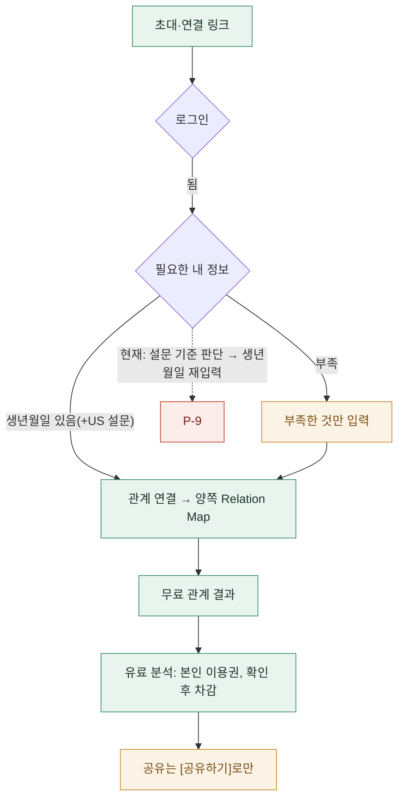
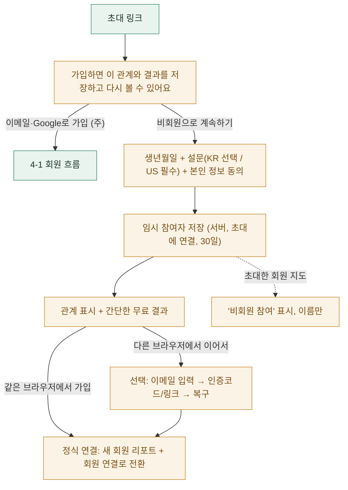
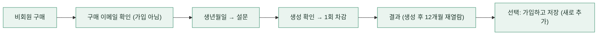
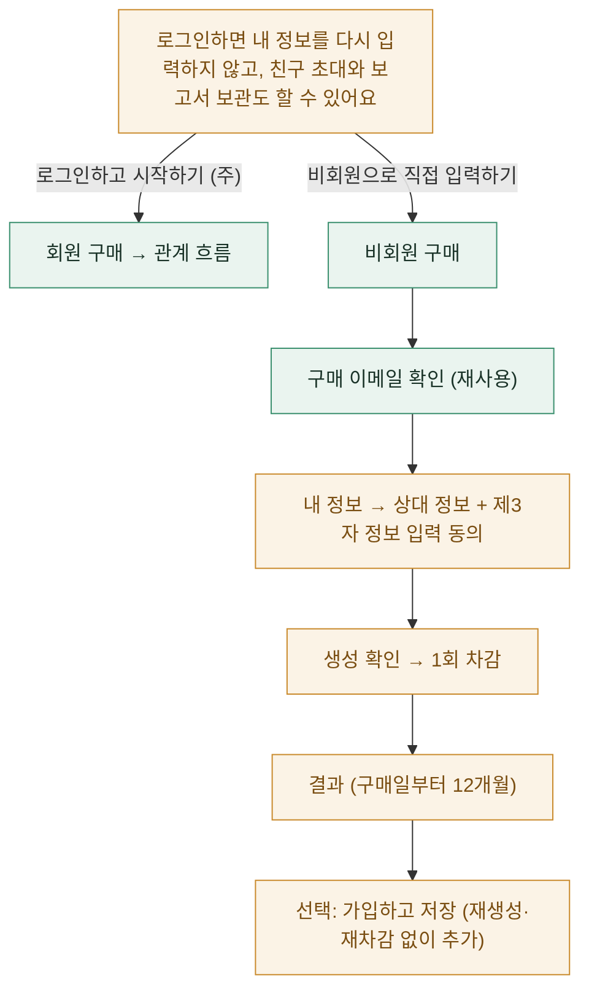
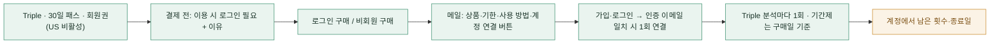
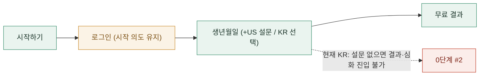

# 목표 IA·사용자 흐름 v2: 최종 정책 통합 (2026-10-09 갱신)

- 이 문서가 기준이다. 앞선 `2026-10-09_ia_user_flow_review.md`와 이 문서의 이전 버전과 충돌하는 내용은 이 문서로 대체한다.
- 이번 단계는 조사, 설계, 계획까지다. 앱 코드·환경변수·DB는 바꾸지 않았다.
- 검증 표기:
  - **[코드]**: 코드를 읽고 확인했다.
  - **[모의]**: 로컬 Postgres와 단위 테스트로 확인했다.
  - **[재현]**: 실제 화면에서 확인했다.
  - 이번 문서에서 [재현]은 없다. localhost 브라우저 접속이 되지 않았다.
- 다이어그램 색:
  - 초록 = 구현됨
  - 주황 = 새로 필요
  - 빨강 = 현재 정책과 어긋남

---

## 1. 최종 정책표

| # | 정책 | 현재 구현 | 차이 | 관련 파일 | DB 변경 |
|---|---|---|---|---|---|
| 1 | 판매 중 상품은 비회원 구매 가능 | ✅ KR 4종 모두 `guestCheckout: true` [코드·모의] | 없음 | `lib/payment/tossCatalog.ts` | — |
| 2 | 단독 Personal: 구매 확인 후 가입 없이 분석, 저장할 때만 로그인 | ✅ [코드·모의] | 없음 | `lib/payment/guestPersonal.ts`, `app/checkout/toss/use` | — |
| 3 | 단건 Relationship 비회원 직접 이용 | ❌ 지금은 "이용 시 계정 연결" 상품이다 | **새 기능** | `tossCatalog.ts`(`isGuestUsePlan`), `accountLinkCopy.ts` | 필요 |
| 4 | Triple·30일 패스·12개월 회원권: 비회원 구매, 이용 시 가입·인증·연결 | ✅ 인증 이메일이 일치할 때 1회 자동 연결 [코드·모의] | 단건 Relationship을 이 그룹에서 분리해야 함 | `accountLinkCopy.ts`, `claim_paid_guest_toss_order` | — |
| 5 | 회원은 무료 개인·관계 분석 | ⚠️ 회원 가능. 단 **KR 설문 생략 시 무료 결과가 열리지 않음**(0단계 #2) | 버그 | `lib/v2/blueprint/useBlueprintBundle.ts` | — |
| 6 | 관계 준비에 유료 Personal이나 무료 결과 생성 불필요 | ✅ `friendAddReadiness`는 로그인 + 리포트 + 생년월일(+US 설문)만 본다 [코드·모의] | 없음 | `lib/relationship/friendAddReadiness.ts` | — |
| 7 | KR 설문 선택 / US 설문 필수 | ⚠️ 입력 단계는 지켜진다. KR 결과·심화 화면은 설문을 요구한다 | 0단계 #2 | `blueprint-preview/**` | — |
| 8 | 미국 결제 비활성 | ✅ `NEXT_PUBLIC_US_CHECKOUT_ENABLED` 미설정 | 유지 | `isCheckoutEnabled` | — |
| 9 | 관계 심화는 생성한 사람만 열람, [공유하기]로만 상대에게 공개 | ❌ **자동 공유** 중 (2장) | **수정 필요(서버 권한 포함)** | `api/relationship/detail`, `analyze/premium`, `premiumByKind.ts` | 필요 |
| 10 | 비회원 단건 Relationship: 생성·재열람·보관 모두 구매일부터 12개월 | ❌ 기능 없음 | 새로 설계 (3장) | — | 필요 |
| 11 | 비회원 초대 참여: 30일 보관, 기간 내 가입 시 이어서 저장, 다른 브라우저는 인증된 복구 링크 | ❌ 브라우저 localStorage에만 있고, 제출 즉시 가입해야 함 | 새 기능 (4장) | `app/invite-birth`, `lib/home/completeInviteOrConnectSignup.ts` | 필요 |
| 12 | 한국어 화면 구매는 원화, 영어 화면 구매는 달러, 상대의 국적·위치와 무관 | ✅ 지역은 화면 언어로만 정한다 [코드] | 없음 | `PurchaseSelectorContent.tsx:175` | — |
| 13 | 다른 언어 보고서는 새 이용권, 같은 언어 재열람은 무료, 자동 생성·차감 금지 | ⚠️ 관계는 언어별 보관, Personal은 **덮어쓰기 + 진입 시 자동 생성** | **우선순위 높음** (6장) | `useSlimV1Integrated.ts`, `reportAnalyses.ts` | 필요 |
| 14 | 계정 저장은 덮어쓰지 않고 추가 | ✅ Personal은 새 리포트로 추가 [코드] | 관계도 같은 방식으로 설계 | `save_guest_personal_to_account` | — |

---

## 2. 관계 심화 보고서 공유 [코드]

### 현재 동작

- 심화 보고서는 두 참여자가 함께 쓰는 `relationship_reports.result_premium_by_kind[종류].byLocale[언어]` 한 칸에 저장된다. **누가 만들었는지 기록하지 않는다**(`lib/relationship/premiumByKind.ts`).
- `/api/relationship/detail`은 참여자라면 누구에게나 이 보고서를 돌려준다(`detail/route.ts:146-155`, `perspective_premium`). 공유 행은 확인하지 않는다.
- `/api/relationship/analyze/premium`은 저장본이 있으면 다른 참여자가 요청해도 **차감 없이** 그대로 돌려준다(`premium/route.ts:244-252`).
- 공유 테이블 `relationship_report_shares`(소유자, 받는 사람, 종류, 상태)는 있다. 하지만 공유 화면(`share/view`)에서만 쓰고, 상세·심화 API의 접근 판단에는 쓰지 않는다.

→ 정책 9와 **불일치**한다. 지금은 화면, API, 직접 URL 어느 쪽으로든 상대가 공유 전에 볼 수 있다.

### 수정 범위 (목표)

| 층 | 변경 |
|---|---|
| DB(JSON) | 심화 보관을 "종류 × 언어 × **만든 사람 리포트**"로 바꾼다. 같은 종류·언어라도 두 사람이 각자 만들 수 있게 한다 |
| 서버 | `detail`·`premium` 응답은 본인이 만든 것, 또는 활성 공유(소유자 = 만든 사람, 받는 사람 = 나, 같은 종류)가 있는 것만 반환한다. 저장본 반환도 같은 규칙으로 한다 |
| 화면 | 상대가 만든 보고서는 공유받기 전에는 보이지 않는다. 내 보고서에만 [공유하기]를 둔다 |
| 기존 데이터 | 만든 사람을 알 수 없는 기존 보고서는 **임의로 숨기거나 옮기지 않는다**. "판단 불가"로 따로 표시해서 지금처럼 두고 결정을 기다린다. 차감 기록(`credit_reservations`)으로 만든 사람을 찾을 수 있는지 DEV에서 먼저 확인한다 |

---

## 3. 비회원 보고서 기한 [코드]

### 현재 Personal 기준 (변경하지 않음)

| 항목 | 실제 코드 | 근거 |
|---|---|---|
| 생성 가능 기한 | **구매일 + 12개월** | `reserve_guest_personal_use`, `20261009090000…sql` |
| 재열람 | 생성한 상태면 삭제 전까지 열람 가능 → **생성일 + 12개월** | `retention_expires_at = now() + 12 months` (`:361`), `guestPersonal.ts:102-139` |
| 입력만 하고 생성 안 함 | **구매일 + 12개월**에 삭제 | `input_expires_at = approved_at + 12 months` (`:273`), 삭제 함수 `:459-490` |
| 환불·취소·실패·테스트 주문 | 즉시 삭제 | 삭제 함수 |
| 삭제 실행 | 함수와 실행 경로(`/api/cron/guest-emails`, CRON_SECRET)는 있다. **정기 실행 설정(`vercel.json` 등)은 저장소에 없다** | `app/api/cron/guest-emails/route.ts` |
| 개인정보처리방침 | 비회원 보관 항목 **없음** | `lib/legal/privacyPolicy.ts` |

→ 앞선 보고의 "생성 후 12개월 보관"은 코드와 **일치**한다. 구매일 기준이 아니다. 이번 지침만으로 Personal 기한은 바꾸지 않는다.

### 비회원 단건 Relationship 목표 (아직 없음)

- 생성 가능, 재열람, 임시 보관을 모두 **구매일 + 12개월**에 끝낸다. 생성일부터 다시 12개월을 주지 않는다.
- 기한 안에 가입하면 이미 만든 결과를 **다시 생성하거나 차감하지 않고** 계정에 새로 추가한다. 내 리포트, 상대 직접 입력 리포트, 관계 보고서를 모두 새로 추가하고 덮어쓰지 않는다.
- 기한이 지나면 입력값(나·상대의 생년월일·설문)과 보고서를 삭제한다. 구매 기록(주문·결제)은 남는다.
- Personal과 기한 기준이 다르다는 점을 화면과 메일에 각각 정확히 적는다.

---

## 4. 친구 초대

### 4-1. 회원이 초대에 응함



- 현재 [코드]: 연결은 자동 수락되고, 양쪽 지도에 반영되며, 같은 연결을 다시 해도 안전하다. 완료 여부를 **설문 기준**으로 판단해서 생년월일을 다시 묻는 경우가 있다.

### 4-2. 비회원이 초대에 응함 (새 기능)



- **보존과 복구**
  - 임시 참여자는 서버에 30일 보관한다. 유료 보고서의 12개월 기준과 별개다.
  - 같은 브라우저: 7일 세션 쿠키로 이어간다. 기존 비회원 Personal 세션 장치를 재사용한다.
  - 다른 브라우저: 쿠키만으로는 이어갈 수 없다. 참여자가 원하면 이메일을 남기고, **그 이메일로 보낸 인증코드나 링크를 확인해야** 복구된다. 이메일을 입력한 것만으로 소유권을 인정하지 않는다. 기존 인증코드 장치(`guest_purchase_codes` 방식)를 재사용한다.
  - 초대 링크: 1회용 초대는 임시 참여가 시작되면 "참여 중"으로 묶는다. 개인 연결 링크는 재사용 가능 상태를 유지한다.
- **지도 표시**
  - 초대한 회원의 지도에는 "비회원 참여"로 표시한다. 이름만 보이고 출생 정보와 설문은 보이지 않는다.
  - 30일 안에 가입하지 않으면 사라진다.
- **정식 연결**
  - 가입한 뒤 임시 참여자 정보로 **새 회원 리포트**를 만든다.
  - 기존 관계 행의 상대를 이 리포트로 바꾸고 회원 연결로 전환한다. 관계 ID를 유지해서 무료 결과를 이어간다.
- **비회원에게 안 되는 것**: 유료 분석, 지속적인 관계 관리, 초대 링크 만들기.
- **동의**: 본인 정보 수집·이용과 보관 기간(30일) 동의. 지금 한국 필수 동의는 본인 정보만 다루므로 같은 항목에 기간을 더한다.

---

## 5. 상품별 흐름

### 5-1. 비회원 Personal (구현됨)



- 구매 이메일 확인은 **회원가입이 아니다**. 결제한 브라우저, 메일 링크, 인증코드 중 하나로 확인하고, 그 기기에서 7일 동안 유지된다. 계정 저장은 Clerk에서 인증한 같은 이메일로만 할 수 있다.

### 5-2. 비회원 단건 Relationship (새 기능)



### 5-3. 계정 필수 상품 (구현됨)



### 5-4. 회원의 무료 분석 진입



---

## 6. 언어·가격·이용권 [코드]

| 항목 | 현재 | 목표 | 변경 |
|---|---|---|---|
| 구매 통화 | 화면 언어로 결정한다(KR → 원화, EN → 달러) | 유지 | — |
| 이용권의 지역·언어 표시 | **없음**. `credit_lots`에 지역·언어 칼럼이 없고, 차감은 사용자와 종류만 본다 | 언어별 상품·이용권을 구분 | **DB**: 앞으로 지급하는 이용권에 `locale` 칼럼(nullable) 추가. 차감 시 보고서 언어와 맞는 이용권을 먼저 쓴다. **기존 이용권은 null로 두고 재분류·무효화하지 않는다**(null 처리 규칙은 결정 D-2) |
| Personal 심화 보관 | 리포트당 한 줄이라 다른 언어로 열면 **덮어쓴다** | 언어별로 보관 | **DB**: 보관 키에 언어 추가. 기존 행은 `content.locale`이 있으면 그 언어로, **없거나 불확실하면 "언어 미상"으로 따로 보존**하고 추정해서 이관하지 않는다 |
| Personal 생성 트리거 | 페이지 진입 시 자동, 언어 변경 시 재생성, 재생성 확인 없음 | 저장본만 표시. 없으면 "이 언어 보고서가 없어요 · 이용권 1회" + **[생성하기]** | 조회와 생성 API 분리, 확인 카드 |
| 관계 심화 | 종류×언어별 보관, 클릭 시 생성. 준비됨 표시가 언어를 구분하지 않음 | 유지 + 준비됨 언어별 | 0단계 #3 |

---

## 7. 기존 주문과 실제 차감

- **차감 실행**
  - `CREDIT_ENFORCEMENT`가 PC의 `.env.local`에 **없다**(꺼짐) [코드].
  - Vercel 운영·프리뷰 값은 이 환경에서 확인할 수 없다.
  - 꺼져 있으면 기록만 남고 잔액은 줄지 않으며, 생성이 막히지도 않는다.
  - 적용 범위: Personal 심화, 관계 심화, 비회원 Personal(생성 예약). 비회원 Personal은 별도의 1회 사용 표시로 중복 생성을 막는다.
- **기존 주문 구분**
  - DB에 접속할 수 없어서 아직 분류하지 못했다. 아래 읽기 전용 SQL을 DEV와 운영에서 실행하면 실구매·테스트·판단 불가로 나뉜다.
  - 실구매가 0건이면 고객 이전 정책은 만들지 않는다. 기존 데이터는 삭제하지 않는다.

```sql
-- 읽기 전용: 결과만 보고, 개인정보 칼럼은 조회하지 않는다.
select
  case
    when is_test then 'test'
    when is_test is false and status in ('granted','paid','refunded','canceled') then 'real'
    else 'unknown'
  end as kind,
  plan_id, status, count(*) as orders,
  count(*) filter (where clerk_user_id is null) as guest_unclaimed
from toss_payment_orders
group by 1, 2, 3
order by 1, 2, 3;
```

- **DEV 실제 차감 검증 절차** (이번에는 설정을 바꾸지 않음)
  1. DEV에서만 `CREDIT_ENFORCEMENT=true`로 개발 서버를 실행한다.
  2. 테스트 결제(토스 테스트 키)로 KR Personal, Relationship, Triple, 패스를 각 1건 산다. 테스트 결제 허용 목록 계정을 쓴다.
  3. `/account/billing`에서 남은 수를 확인한다.
  4. 심화 생성 → 남은 수 −1을 확인한다. 같은 언어로 재열람 → 변화 없음, 다른 언어로 생성(확인 후) → −1을 확인한다.
  5. Triple은 3회 생성 후 0이 되고, 4번째는 구매 안내가 나오는지 확인한다.
  6. 패스는 구매일 + 30일 만료를 확인한다. DB의 `expires_at`을 조회한다.
  7. 비회원 Personal 저장 후 계정에서 재열람해 추가 차감이 없는지 확인한다.
  8. 끝나면 DEV 설정을 원래대로 되돌린다.

---

## 8. 안내 원칙

- 관계 상품: "로그인하면 내 정보를 다시 입력하지 않고, 친구 초대와 보고서 보관도 할 수 있어요." 주 버튼은 로그인, 비회원 선택은 유지한다.
- 계정 필수 상품: 결제 전에 "이용할 때 로그인이 필요해요"와 이유 한 줄을 보여준다.
- 화면과 메일은 같은 문구 원천(`accountLinkCopy.ts`)을 쓴다. 구현되지 않은 저장·복구 기능은 약속하지 않는다. 비회원 초대 복구, 단건 관계 비회원 이용, 만료 알림이 여기에 해당한다.
- 구매 이메일 확인과 회원가입은 따로 표기한다.
- 발신·답장 주소는 support@ahaitsme.com으로 유지한다.
- 만료 알림 메일은 후속 단계로 둔다.

---

## 9. 단계별 계획

| 단계 | 내용 | DB | 검증 |
|---|---|---|---|
| **0** | 버그 3건 (10장) | 없음 | 모의 + 로컬 재현 |
| **1** | Personal 언어별 저장·생성 확인·차감 검증 (11장) | DEV: 보관 키 + 이용권 locale 칼럼 | 모의 + DEV 차감 절차 |
| **2** | 관계 심화 "만든 사람만 열람 + 공유하기" (2장) | DEV: JSON 구조, 기존 데이터 보존 | 모의 + 권한 테스트(직접 API 차단) |
| **3** | 공통 내 정보 상태·입력 화면·로그인 후 복귀 | 없음 | 모의 + 재현 |
| **4** | 초대 회원 흐름 정리(부족한 것만 입력) → 비회원 초대 참여(30일, 인증 복구) | DEV: 임시 참여자 | 모의 + 재현 |
| **5** | 비회원 단건 Relationship(구매일 + 12개월) | DEV: 비회원 이용 보관 확장 | 모의 + 재현 |
| **6** | 계정 이용권 현황, 개인정보처리방침 비회원 항목, 삭제 정기 실행, 만료 알림 | 운영 반영은 별도 승인 | — |
| **7** | 디자인·문구 다듬기 | — | 재현 |

---

## 10. 0단계 버그 수정 범위

| # | 문제 | 원인 [코드] | 수정 | 영향·주의 |
|---|---|---|---|---|
| 1 | 친구 목록을 불러오면 유효한 초대 링크가 삭제됨 | `app/api/relationship/list/route.ts:90`이 매번 `cleanupStaleOpenInvites`를 호출하고, 친구가 1명 이상이면 연결 안 된 열린 초대를 **모두** 지운다(`lib/relationship/cleanupStaleOpenInvites.ts:15-28`) | 목록 조회에서 삭제 호출 제거. 정리는 "생성 후 N일 지난 열린 초대"만 별도로 처리(N은 결정 D-6) | 이미 삭제된 초대는 복구할 수 없다. 새로 만든 초대부터 정상 |
| 2 | KR 무료 결과가 선택 설문을 강제 | `useBlueprintBundle.ts:41-52`가 설문 세션을 필수로 요구한다. 없으면 `blueprint-preview`, `current`, `essence`, **`essence/deep`(유료 포함)** 모두 `/survey-v2`로 보낸다 | 번들의 설문을 선택값으로 바꾼다. 설문이 없으면 결과 화면은 본질(생년월일 기반) 중심으로 보여주고 "현재 상태 비교는 설문 후"를 안내한다. `essence`와 `essence/deep`은 설문 없이 열린다 | 대시보드의 현재 상태 비교(레이더·차이)는 설문이 있어야 한다. 화면 구성은 결정 D-5 |
| 3 | 관계 보고서 준비 상태가 언어를 구분하지 않음 | `detail/route.ts:430` `premium_kinds_ready`가 언어 무관 `hasPremiumCacheForKind`를 쓴다 | 언어별 `hasPremiumCacheForKindLocale`로 교체 | 다른 언어 보고서만 있는 종류는 "준비 안 됨"으로 바뀐다(정상 동작) |

---

## 11. 다음: Personal 언어별 저장·생성 확인·차감 검증 계획

1. **조회와 생성 분리**
   - `GET /api/v2/deep/essence?reportId&locale` → 저장본만 반환한다(없으면 `not_generated`).
   - `POST`는 사용자가 확인했을 때만 호출한다.
2. **화면**
   - `useSlimV1Integrated`의 자동 POST를 제거한다.
   - 저장본이 없으면 생성 확인 카드를 보여준다(언어, 이용권 1회, 남은 수).
   - 재생성도 확인을 거친다. 관계의 `RegenerateConfirmDialog` 패턴을 재사용한다.
3. **보관**
   - `report_analyses`에서 Personal 심화를 언어별로 구분한다(예: 키에 `locale`).
   - 기존 행은 `content.locale`이 확실하면 그 언어로 둔다. 불확실하면 "언어 미상"으로 보존하고 노출 규칙은 결정 D-1.
4. **이용권**
   - 신규 지급분부터 `locale`을 기록한다. 기존 이용권은 그대로 둔다.
5. **비회원 Personal 저장분**
   - 주문 언어로 기록된 그대로 이전한다. 이미 구현됐다.
6. **검증**
   - 모의: 같은 언어 재열람 0차감, 다른 언어 생성 1차감, 진입·새로고침·언어 변경 0차감.
   - DEV: 7장 절차.

---

## 12. 결정이 필요한 사항 (추천)

| # | 질문 | 추천 |
|---|---|---|
| D-1 | 언어를 판단할 수 없는 기존 Personal 심화 보고서 | 별도 보존. 원래 리포트 화면의 "이전 보고서"로만 보여주고 자동 이관하지 않음 |
| D-2 | 언어 표시가 없는 기존 이용권(null)의 사용 범위 | 어느 언어든 사용 가능(현재 동작 유지). 신규만 언어 구분 |
| D-3 | 만든 사람을 알 수 없는 기존 관계 심화 보고서 | 차감 기록으로 확인되면 그 사람 소유로 두고, 안 되면 지금처럼 양쪽 열람 유지. 공유 상태는 바꾸지 않음 |
| D-4 | 같은 종류·언어를 상대도 따로 만들 때 | 각자 보관(각자 1회). 공유받은 보고서가 있으면 생성 전에 알려줌 |
| D-5 | KR 설문 없는 무료 결과 화면 구성 | 본질(생년월일) 결과 + "설문하면 현재 상태 비교" 카드 1개 |
| D-6 | 열린 초대 정리 기준 | 생성 후 30일 지난 미사용 초대만 정리 |

---

## 13. 확정된 결정 (2026-10-09)

| # | 결정 |
|---|---|
| D-1 | 언어를 알 수 없는 기존 Personal 심화 보고서는 원본을 보존한다. 자동 재생성과 덮어쓰기를 금지한다 |
| D-2 | 언어 표시가 없는 기존 이용권은 지금 사용 범위를 유지한다 |
| D-3 | 소유자를 알 수 없는 관계 심화는 원본을 보존하고 별도 검토 대상으로 둔다. "양쪽 열람 유지"로 확정하지 않는다 |
| D-4 | 관계 심화는 각자 이용권으로 따로 생성할 수 있다. 본인만 열람하고 [공유하기]로 선택 공유한다 |
| D-5 | 한국은 설문 없이 생년월일만으로 무료·유료 분석을 쓸 수 있다. 미국은 설문 필수를 유지한다 |
| D-6 | 쓰지 않은 초대는 생성 후 30일에 만료한다. 참여·연결된 관계와 참여자 데이터의 보관 기한과는 별개다 |

## 14. 0단계 결과 (2026-10-09)

| # | 수정 | 파일 | 검증 |
|---|---|---|---|
| 1 | 친구 목록 조회에서 초대 삭제를 없앴다. 쓰지 않은 초대는 30일이 지나면 목록에서 숨기고, 연결(`invite/complete`)도 거절한다(410 `invite_expired`). 초대 안내(`invite/info`)는 `available`/`expired` 값만 추가로 알려준다(개인정보 없음). 초대 페이지는 쓸 수 없는 초대에 시작 버튼을 숨긴다 | `app/api/relationship/list/route.ts`, `app/api/invite/complete/route.ts`, `app/api/invite/info/route.ts`, `app/invite/InviteContent.tsx`, `lib/relationship/inviteExpiry.ts`, `lib/home/completeInviteOrConnectSignup.ts`, `app/homecontent.tsx` | 모의 + 코드 |
| 2 | KR은 설문 없이 무료 결과·본래의 나·유료 Personal 심화 페이지가 열린다. 설문 기반 항목(현재 성향 레이더·요약·현재 탭)은 빼고 "설문하고 비교하기"를 안내한다. 생년월일이 없으면 생년월일 화면으로 보낸다. US는 그대로다 | `lib/v2/blueprint/useBlueprintBundle.ts`, `lib/v2/blueprint/blueprintMissingStep.ts`, `app/blueprint-preview/**`, `components/results/StitchResultsDashboard.tsx`, `StitchLiteResultPanel.tsx`, `components/v2/DualAxisRadarChart.tsx` | 모의 + 코드 |
| 3 | 관계 심화 "준비됨"을 보고 있는 언어 기준으로 판단한다(상세 `premium_kinds_ready`, 허브 목록, 상태 API) | `app/api/relationship/detail/route.ts`, `list/route.ts`, `status/route.ts`, `lib/relationship/isRelationshipPremiumComplete.ts` | 모의 + 코드 |

- 아직 처리하지 않은 것
  - 만료된 초대를 실제로 삭제하는 작업(연결 데이터 영향을 확인한 뒤 별도로 진행).
  - 관계 지도(`fetchRelationshipMapConnections`)는 언어 없이 캐시하므로 "어느 언어로든 있음" 판단을 유지한다.
- 생성 API 확인 [코드]
  - 심화 생성(`/api/v2/deep/essence` → `runSlimIntegratedReport`)은 `surveyAnswers: null`로 동작하고, 화면용 `radar_current`는 null로 저장된다.
  - **남은 점:** 설문이 없을 때 프롬프트에는 중립값 50이 "설문 기반 현재 점수"라는 이름으로 들어간다. 사용자에게 보이지는 않지만, 1단계에서 설문이 없을 때의 프롬프트 분기를 검토한다.

## 15. 미해결: 관계 심화 자동 공개 (별도 단계)

- 현재 [코드]: 한쪽이 만든 관계 심화를 상대가 공유 없이 화면·직접 URL·API(`detail`, `analyze/premium` 저장본 반환)로 볼 수 있다. 만든 사람 기록이 없다.
- 결정 D-4와 **불일치**하며, 0단계에서는 고치지 않았다.
- 해결 단계: 보관 구조(만든 사람) 변경 + 서버 권한 + 공유 연동. 기존 보고서는 원본을 보존하고 소유자 불명은 검토 대상으로 둔다(D-3).

## 16. 1단계 결과: Personal 조회·생성 분리, 언어별 저장·이용권 (2026-10-09)

전제: DEV DB는 클라우드·PC VM 어디서도 직접 접속되지 않는다. DB 변경은 SQL 파일로 만들고 로컬 Postgres에서 검증했다. DEV 적용과 실제 결제 검증은 사용자가 직접 실행한다.

| # | 변경 | 파일 | 검증 |
|---|---|---|---|
| 1 | 조회와 생성 분리: `GET /api/v2/deep/essence?reportId&locale`은 저장본만 읽는다(`ready`·`legacy_unknown`·`not_generated`·`in_progress`). `POST`는 `confirmGenerate: true`일 때만 생성한다. 같은 언어 저장본이 있으면 생성·차감 없이 그대로 돌려준다(`generated: false`). 잠금을 잡은 뒤 한 번 더 확인해 동시 요청도 1회만 생성한다 | `app/api/v2/deep/essence/route.ts`, `lib/report/personalDeepEssenceView.ts`, `lib/report/personalPremiumGenerationLock.ts` | 모의 |
| 2 | 화면: 진입·새로고침·언어 전환은 GET만 한다. 저장본이 없으면 [생성하기 (이용권 1회)] 카드를 보여준다. 다시 생성은 화면 안 확인 단계를 거치고, 이전 보고서는 보관된다고 안내한다. 결제 후에는 상태만 다시 읽고 자동 생성하지 않는다. `?autostart=1` 자동 생성은 없앴다 | `lib/v1/slim/useSlimV1Integrated.ts`, `app/blueprint-preview/[reportId]/essence/deep/page.tsx`, i18n `blueprint.deepGenerate` | 모의 + 코드 |
| 3 | 언어별 저장: `deep_essence_structured_ko` / `_en` 행을 새로 쓴다. 기존 `deep_essence_structured` 행은 다시 쓰지 않고 지우지 않는다. 기록된 언어가 같으면 그 언어 보고서로, 언어가 없으면 "이전 보고서"로 원본 그대로 보여준다(D-1). 다시 생성은 `save_personal_deep_analysis`가 이전 내용을 `report_analysis_history`에 먼저 보관한다 | `supabase/migrations/20261009120000_…sql`, `lib/report/reportAnalyses.ts` | 로컬 Postgres |
| 4 | 비회원 Personal 계정 저장: 주문 언어(`report_locale`)로 `_ko`/`_en` 행에 넣는다. 언어가 없으면 기존 타입으로 원본 보존. 비회원 화면은 1주문 1보고서(주문 언어) 그대로다 | 같은 migration(`save_guest_personal_to_account`) | 로컬 Postgres |
| 5 | 이용권 언어: 새로 지급되는 lot에 `locale`을 기록한다(트리거: `kr_purchase_grants`→ko-KR, `us_purchase_grants`·미국 멤버십→en-US, 프로모·관리자·테스터·선물→NULL). 구매·claim(`process_toss_order`)·멤버십 모두 같은 경로다. 기존 lot은 채우지 않아 NULL 그대로 어느 언어든 쓴다(D-2). `reserve_credit`은 같은 언어 lot 또는 NULL lot만 쓴다. 만료 임박 우선 규칙은 유지하고, 같은 만료면 같은 언어 lot을 먼저 쓴다. 관계 심화 차감도 같은 함수라 같은 규칙이다 | 같은 migration(`credit_lots.locale`, `credit_lots_set_locale`, `reserve_credit`) | 로컬 Postgres |
| 6 | 설문 없는 분석(KR): 중립값 50을 AI에 보내지 않는다. 설문이 없으면 "설문 미입력, 설문 기반 해석 생략"을 프롬프트에 명시하고, 현재 점수 하한(clamp)과 설문·타고난 성향 비교 근거(Part01 evidence)를 만들지 않는다. 화면은 "현재" 계열·최고/최저 축 카드를 숨기고 생략 안내를 보여준다(회원·비회원 같음). US 설문 필수는 그대로다 | `lib/v1/slim/runSlimIntegratedReport.ts`, `lib/v1/slim/surveyAnalysis.ts`, `lib/prompts/deepEssenceStructured.ts`, `lib/report/runDeepEssenceStructuredLlm.ts`, `lib/report/coerceDeepEssenceStructured.ts`, `components/results/deep/*`, `StitchDeepEssenceView.tsx`, `GuestUseClient.tsx` | 모의(프롬프트 문자열) |

검증 결과 [로컬 Postgres, 실제 SQL 함수 / 모의]
- `tests/scripts/run-personal-locale-sql.sh`: KR lot=ko-KR, 다른 언어 거절, 같은 언어 1회 차감 후 잔액 부족 거절, 기존 NULL lot 두 언어 사용, 실패 시 1회 복구(두 번 release해도 1회), Triple 3회 후 거절·en-US 거절, 패스 만료 거절, 차감 꺼짐이면 기록만, US lot=en-US, 언어별 행·재생성 보관·기존 행 보존, 동시 4요청 중 1건만 성공. migration 재실행 안전.
- 기존 `credit-lifecycle`·`one_time_membership_toss` SQL 테스트: 새 migration 적용 후에도 통과.
- `tests/unit/personal-locale-view.test.ts`(11): 진입 0회, 생성 1회, 재열람 0회, 동시 클릭 1회, 다른 언어 1회, 실패 0회, 잔액 부족. 의도가 바뀐 기존 단위 테스트 3개(자동 재시도·클라이언트 캐시 전제)를 새 규칙으로 고쳤다.
- 실제 토스 테스트 결제·DEV DB·브라우저 확인: **아직 안 함**(접속 불가). 아래 절차로 사용자가 실행한다.

CREDIT_ENFORCEMENT [코드]
- `lib/credits/creditEnforcementPolicy.ts`: `process.env.CREDIT_ENFORCEMENT === "true"`일 때만 실제 차감한다. PC의 `.env.local`에는 없다 → 지금 DEV 로컬은 **차감 꺼짐**(기록만). Vercel 값은 확인하지 못했다.
- 차감이 꺼진 상태는 출시 준비 완료가 아니다. 위 SQL 검증은 `p_enforced=true`로 함수 자체를 검증한 것이고, 앱에서 켠 상태의 실제 확인은 아래 DEV 절차 후에 기록한다.

DEV 실행 절차 (사용자)
1. 개발 서버 중지 → 패치 적용 → `.next` 삭제.
2. Supabase DEV(ahaitsme-dev) SQL Editor: `supabase/DEV_CHECK_20261009c_PERSONAL_LOCALE_STATE.sql`(전) → `DEV_APPLY_20261009c_PERSONAL_LOCALE.sql` → `DEV_CHECK…`(후). 운영 DB에는 실행하지 않는다. **앱 코드보다 SQL을 먼저 적용**(안 하면 저장이 실패하고 이용권은 복구된다).
3. PC `.env.local`에만 `CREDIT_ENFORCEMENT=true` 추가 → `npm run dev`. Vercel·운영 환경변수는 건드리지 않는다.
4. 테스트 계정으로 로그인, `supabase/DEV_VERIFY_20261009c_CREDITS_FOR_USER.sql`의 `user_REPLACE_ME`를 본인 DEV 계정 id로 바꿔 단계마다 확인한다.
   - (실제 토스 테스트 결제) `http://localhost:3000/kr/pricing` → Personal 단건 테스트 결제 → lot `ko-KR` 1개 확인.
   - `http://localhost:3000/kr/blueprint-preview/<reportId>/essence/deep` 진입·새로고침 → 생성 카드만, 원장 변화 없음.
   - [생성하기] 빠르게 두 번 → 보고서 1개, `reservation_hold` 1건·남은 0. 새로고침·재진입 → 변화 없음.
   - 언어를 EN으로 바꿔 같은 화면(`/blueprint-preview/<reportId>/essence/deep`) → "아직 없음" 카드. [Generate] → KR 이용권만 있으면 402(잔액 부족 안내) 확인.
   - (모의 데이터) `DEV_TESTDATA_…sql` [A]로 언어 없는 테스트 이용권 1개 지급 → EN [Generate] 1회 차감 → KO로 돌아가 재열람 0회.
   - Triple: `/kr/pricing?for=relationship`에서 Triple 테스트 결제 → 관계 심화 3회 생성 후 4번째 402.
   - 패스 만료: 패스 테스트 결제 → `DEV_TESTDATA` [B]로 만료 처리 → 생성 시 402. ([A] 이용권이 남아 있으면 그걸 쓰므로 먼저 다 쓰거나 다른 계정으로 한다.)
   - 실패 복구: `.env.local`의 `OPENAI_API_KEY`를 잠시 비우고 생성 → 오류 안내, `reservation_release` +1, 남은 수 그대로. 키는 바로 되돌린다.
5. 끝나면 `.env.local`에서 `CREDIT_ENFORCEMENT=true`를 지우거나 유지할지 정하고, 결과·복원 여부를 이 문서에 기록한다.

남은 점 / 이번 범위 밖
- 계정의 이용권 요약(`getCreditLotSummary`, 내 이용권·구매 화면 안내)은 아직 언어를 나누지 않고 합계를 보여준다. 다른 언어 이용권만 있을 때 "보유"로 보일 수 있다(차감 판단은 서버 `reserve_credit`이 정확히 한다).
- 관계 분석의 설문 없는 상대(`buildNeutralV2Profile`)는 이번 범위(Personal)에서 바꾸지 않았다.
- 기존 단위 테스트 중 0단계 이전부터 실패하던 것들은 그대로다.
- 관계 심화 자동 공개(§15)는 여전히 미해결이다. 다음 단계: 소유권·선택 공유.

### 16-1. 1단계 확인 수준 (2026-10-11 기록)
- Personal 생성·차감은 **사용자 PC 로컬에서 정상으로 보였으나 전체 검증은 미완료**다.
- 미완료 항목(§16 DEV 절차 기준): 차감을 켠 상태(`CREDIT_ENFORCEMENT=true`)의 전 시나리오 기록, 다른 언어 생성 1회, Triple·패스 만료, 실패 복구, 설정 복원 여부 기록.

## 17. 2단계: 관계 심화 소유권·선택 공유 (2026-10-11)

기존 공유 기능(`relationship_report_shares`, `share/create|revoke|status|view|inbox`, `ReportShareSection`)을 보완했다. 새 공유 시스템은 만들지 않았다.

### 17-1. 규칙과 구현

| 규칙 | 구현 | 파일 |
|---|---|---|
| 보고서를 관계·생성자·종류·언어별로 구분, 고유 ID | `relationship_premium_reports`(unique: 관계+생성자 보고서+종류+언어). 다시 생성은 `save_relationship_premium_report`가 이전 내용을 `relationship_premium_report_history`에 보관 후 교체 | `supabase/migrations/20261011090000_relationship_premium_ownership.sql` |
| 기존 공유 기록을 보고서에 연결 | `relationship_report_shares.premium_report_id` 추가. 새 공유는 보고서 1개에 연결, 보고서당 활성 공유 1개. 기존 행은 값 그대로(NULL = 이전 공유) | 같은 migration |
| 모든 API 같은 서버 권한 판단 | `lib/relationship/premiumAccess.ts` 하나로 판단: 내 보고서(보고서 id + 로그인 계정 일치) / 상대 보고서 중 나에게 **활성 공유** 중인 것 / 이전 보고서(레거시) | detail, analyze/premium, list, status, 홈 요약, 관계 지도 |
| 공유 생성·취소는 생성자만 | `assertPremiumReportOwner`: 참여자 확인 + 그 보고서의 생성자(보고서 id·계정)여야 함. 아니면 403 `not_report_owner`. 이전 보고서에는 새 공유를 만들 수 없음 | `lib/relationship/reportShare/assertPremiumReportOwner.ts`, `share/create·revoke·status` |
| 권한 없는 보고서는 본문·요약 미포함 | 상세는 읽을 수 있는 것만 담은 `byKind`로 응답을 만든다. 생성 API는 공유 안 된 상대 보고서를 반환·재사용하지 않고 내 보고서를 새로 만든다 | detail, analyze/premium |
| 화면: [내 분석]/[공유받은 분석] 구분, 준비 상태는 내 권한 기준 | `PremiumSourceBar`(내 분석 / ○○님이 공유한 분석 / 이전 분석 전환, 내 분석이 없으면 [내 이용권으로 내 분석 만들기]). 공유 영역은 내 보고서일 때만. 공유받은 보고서에는 "다시 생성" 없음. 목록·상태·홈·지도의 "준비됨"은 내가 열 수 있는 보고서 기준 | `components/relationship/detail/PremiumSourceBar.tsx`, `RelationshipView.tsx`, `useRelationshipDetail.ts`, `RelationshipPremiumSection.tsx` |
| 공유 취소 안내 | "상대는 이 보고서를 더 이상 새로 열 수 없어요. 이미 본 내용을 되돌리지는 않아요." | i18n `relationshipMap.reportShare` |
| 차감 | 내 보고서·공유받은 보고서·이전 보고서 열람은 생성·차감 없음. 내 보고서 생성(처음·[내 분석 만들기]·확인한 다시 생성)만 1회. 언어별 이용권 규칙(`reserve_credit`)은 그대로. 생성 잠금은 생성자별이라 두 사람이 동시에 각자 만들 수 있고, 같은 사람의 중복 클릭은 1회만 | analyze/premium, `relationshipPremiumGenerationLock.ts` |

추가로 막은 것 [코드]
- 상세 API가 동료·친구 종류에서 보고서가 **없어도** 결정적 보고서를 만들어 `result_premium_by_kind`에 저장하던 동작(유료 내용 무료 노출 + 기존 행 수정)을 없앴다. 이제 읽을 수 있는 보고서가 오래된 형식일 때만 화면용으로 갱신하고, 저장은 내 보고서에만 한다.
- 공유 링크는 보고서가 만들어진 언어 화면으로 연다.

### 17-2. 이전 보고서·이전 공유 기록 처리안 (결정 필요, 이번에 적용 안 함)

현재 상태 [코드]
- 이전 보고서(`relationship_reports.result_premium_by_kind`): 생성자 기록 없음. 이용권 원장은 예약 행 삭제 후 관계·종류를 잃어 근거가 못 된다.
- 생성 로그(`relationship_analysis_logs`, analysis_level=premium)에는 생성을 요청한 참여자 보고서(`viewer_report_id`, 생성 시 소유 확인됨)가 남는다. 단, 기록은 실패해도 진행되는 부가 기록이고, 이후 상대가 다시 생성하면 같은 칸이 덮였을 수 있다.
- 이전 공유 행: 관계·종류 단위, 보고서 연결 없음, 참여자 누구나 만들고 취소할 수 있던 구조.

이번 단계에서 한 것: **아무것도 바꾸지 않음.** 이전 보고서는 지금처럼 두 참여자 모두에게 "이전 분석"으로 보이고(공개 범위 유지), 새 생성은 그 칸을 쓰지 않는다. 이전 공유 행은 그대로 두며 링크·받은 목록도 지금처럼 동작한다(열람 권한은 원래도 공유 행과 무관했다).

| 분류 (DEV_CHECK §3) | 의미 | 처리안 |
|---|---|---|
| A. 기록 없음 | 생성 로그가 없음 | 소유자 지정 불가. 선택지: (A1) 지금처럼 두 사람 열람 유지 + "이전 분석" 표시(추천: 이미 본 사람에게서 빼앗지 않음) / (A2) 두 사람 모두에게 숨기고 원본만 보관 |
| B. 한 사람만 요청 | 한 참여자의 생성 로그만 있음 | **후보**로만 표시. 확정하려면 로그 스냅샷과 저장 내용이 같은지 운영자가 확인한 뒤, 그 사람의 새 보고서로 **복사**(원본 유지)하는 별도 migration. 자동 지정은 하지 않음 |
| C. 두 사람 모두 요청 | 덮어쓰기 가능성 | 소유자 지정 불가. A와 같은 선택지 |
| 이전 공유 행 | 보고서 연결 없음 | (추천) 그대로 보존. B를 확정해 복사할 때만, 그 보고서의 생성자가 만든 공유이면 새 보고서에 연결하는 행을 **추가**. 기존 행은 수정·삭제하지 않음 |

결정이 필요한 것: A·C의 노출(A1/A2), B 확정 절차 실행 여부.

참고(별도 결정): 출생 정보·설문 변경 시 `invalidateRelationshipPremiumsForReport`가 이전 보고서 칸을 비운다. 이전 보고서 원본 보존 원칙과 충돌하므로 이 정리 전에 동작 변경 여부를 정해야 한다. 새 보고서 표에는 영향이 없다.

### 17-3. 검증

모의·로컬 [실행함]
- `tests/scripts/run-relationship-ownership-sql.sh`(로컬 Postgres, 실제 SQL): 각자 생성 시 서로·이전 행 덮어쓰지 않음, 다시 생성은 본인 것만 교체·보관, 다른 언어 별도, 타인·비참여자 저장 거부, 각자 공유 가능·보고서당 활성 1개·취소 이력 보존·재공유, 잠금 생성자별(중복 클릭 차단), A·B 각자 1회 차감·중복 차감 없음, migration 재실행 안전, 기존 공유 행 변경 없음.
- `tests/unit/relationship-premium-ownership.test.ts`(15): 생성자 / 공유 전 상대 / 공유 후 상대 / 공유 취소 후 상대 / 다른 사람에게 공유된 경우 / 무관한 계정 / 계정 불일치 / 양쪽 별도 생성·전환 / 이전 보고서 / 생성 API 판단(재열람 0, 공유 안 된 상대 보고서 미사용, 공유받은 보고서 0, 내 분석 만들기, 다시 생성, 다른 언어) / 모든 라우트 같은 판단 사용.
- 새로고침·재조회·직접 URL·API 차단: 상세·생성·목록·상태가 매 요청마다 서버에서 활성 공유를 다시 확인하는 구조로 검증(모의). 실제 브라우저·DEV DB 확인은 **안 함**.

DEV [사용자 실행 필요]
1. 개발 서버 중지 → 패치 적용 → `.next` 삭제.
2. Supabase DEV SQL Editor: `DEV_CHECK_20261011_RELATIONSHIP_OWNERSHIP_STATE.sql` → `DEV_APPLY_20261011_RELATIONSHIP_OWNERSHIP.sql` → `DEV_CHECK…`. **앱보다 SQL 먼저.** 운영 DB에는 실행하지 않는다.
3. 계정 3개(A, B, C). A·B는 서로 연결된 관계, C는 무관.
   - A: 관계 심화 생성 → [내 분석] 표시, 공유 영역 보임.
   - B(공유 전): 같은 관계·종류 화면 → 심화 "준비 안 됨", 본문 없음. 브라우저 개발자도구에서 `/api/relationship/detail?...&premiumSource=shared` 응답에 보고서 본문이 없는지.
   - A: [공유하기] → B 새로고침 → "A님이 공유한 분석"으로 열림, 차감 없음.
   - A: [공유 중지] → B 새로고침·공유 링크·직접 URL → 다시 "준비 안 됨".
   - B: [내 이용권으로 내 분석 만들기] → B 이용권 1회, A 보고서 그대로. A 화면에서 A 보고서 변화 없음.
   - C: A의 관계 URL·공유 링크 → 403/거절.
   - 같은 버튼 빠르게 두 번 → 1회 차감(`DEV_VERIFY_20261009c_CREDITS_FOR_USER.sql`).
4. 결과와 `CREDIT_ENFORCEMENT` 복원 여부를 이 문서에 기록.

## 18. 남은 리팩토링 1~7단계 (2026-10-11)

> 확인 수준: 아래 모두 **로컬 모의 테스트·코드 검토까지**. 실제 브라우저 통합 테스트는 미실행(체크리스트: `2026-10-11_integration_test_checklist.md`). DEV SQL은 파일만 준비, 적용 안 함.
> 변경 전 백업: PC 브랜치 `backup/pay-toss-kr-test-20261011-rel-ownership`(6fbe43e), IA 문서 사본 `.git/stale-ia_target_v2-backup-20261011.md`.

| 단계 | 커밋 | 결과 |
|---|---|---|
| 1 로그인·복귀 공통화 | e22b329 | 로그인·한국 약관 후 원래 화면으로 복귀. 복귀 주소는 서버(`/api/auth/continue`)에서 내부 경로만 허용. 정보 단계 규칙 한 곳(`lib/profile/infoSteps.ts`) |
| 2 입력·상태 통합 | da6cb90 | 정보 변경 시 관계 보고서 비우기 중단, 분석 교체 전 기록 보관, 설문 삭제 API 중단, "생성 당시 정보 기준" 표시(입력 지문만 저장), 초대 가입이 기존 생년월일을 덮어쓰지 않음. DEV: `DEV_APPLY_20261011b` |
| 3 친구 초대 | 914d9d6 | 회원은 부족한 정보만. 비회원 참여(30일, 선택 이메일 인증·복구, 가입 시 연결). 토큰만으로 소유권 불인정. DEV: `DEV_APPLY_20261011c` |
| 4 비회원 단건 Relationship | 157b750 | Personal의 구매 확인·세션·1회 사용 재사용. 내 정보→상대 정보+안내 확인→명시적 생성→결과, 구매일+12개월, 가입 시 같은 보고서 저장. **새 주문만** 비회원 사용(주문 생성 시 표시), 이전 주문은 기존 계정 흐름 유지. 회원 생성 로직은 공용 핸들러로 이동(동작 동일). DEV: `DEV_APPLY_20261011d` |
| 5 이용권·Journal | 48b110e, 86a0b99 | 이 화면 언어로 쓸 수 있는 이용권·공용 이용권·Triple 잔량·패스 종료일 표시, 한국 화면 미국 회원권 문구 제거, Journal 한도 → 30일 패스, 환불된 패스 제외. Journal 계정 저장·중복 없는 이관 구현했으나 **방침 개정 전까지 꺼 둠**. DEV: `DEV_APPLY_20261011e` |
| 6 보관·메일 | 63edc1a | 정기 실행 **미연결**(자동 정리 안 됨) 확인, 연결 절차·DEV 1회 실행 스크립트, 방침 수정안 초안. 발신·답장 support@ 유지 |
| 7 UX·통합 테스트 준비 | (문서) | 새 화면은 주요 버튼 1개 기준으로 구성, 한·영 키 누락 없음 확인. 통합 테스트 체크리스트 작성 |

### 18-1. 결정 필요
1. 비회원 초대 30일 만료 시, 초대한 사람이 유료 보고서를 이미 만든 관계: 지금은 관계 기록 유지 + 참여자 이름·생년월일 삭제. 초대한 사람 지도에서도 숨길지?
2. 비회원 Relationship 상대 정보 안내 문구 법률 검토.
3. 비회원 Personal을 기존 계정에 저장할 때 새 프로필이 하나 더 생기는 점(이전 구현) — 기존 프로필에 붙일지.
4. 구매 이메일(주문 기록) 보관 기간.
5. 17-2 이전 관계 보고서 처리안(미결).
6. 정기 실행 방식(Vercel Hobby 하루 1회 / Supabase pg_cron 매시 / 외부 스케줄러).
7. 비회원 Relationship 구매자가 이미 회원 지도에 같은 상대가 있는 경우: 저장 시 새 수동 인물로 추가됨(기존 인물과 합치지 않음).
