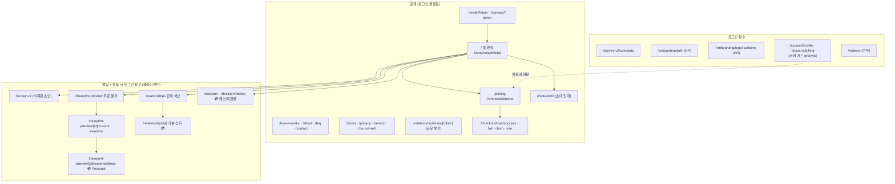
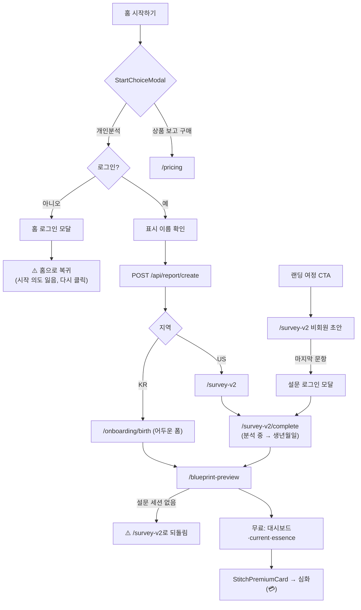
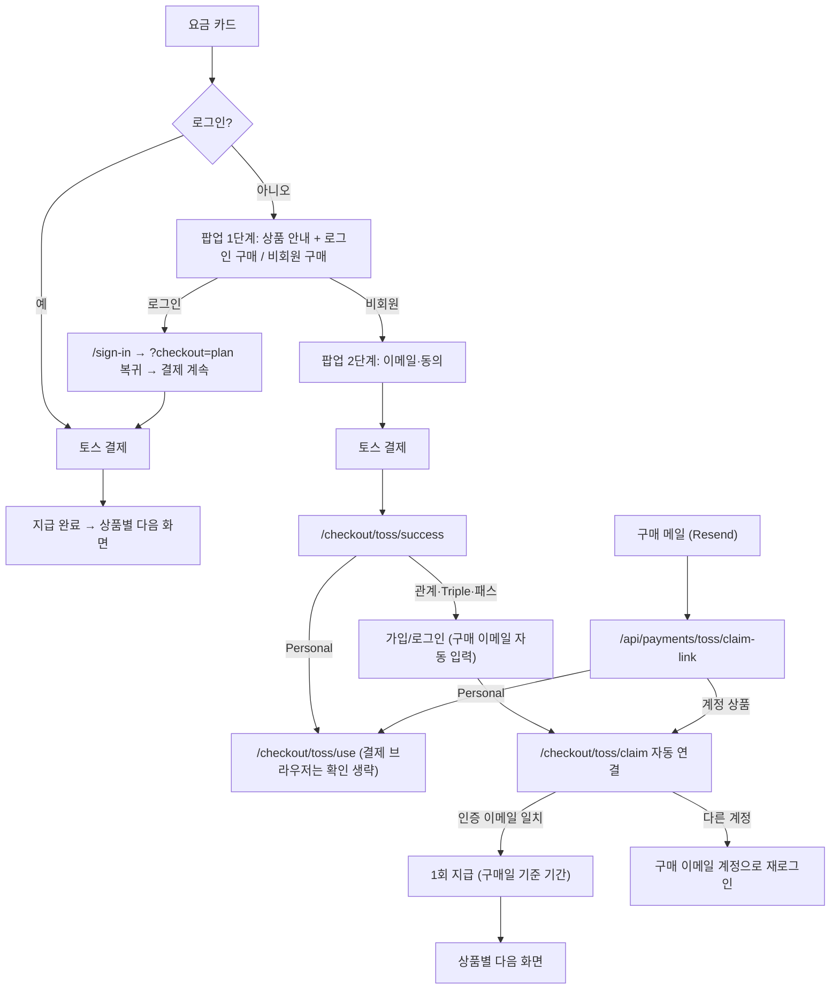
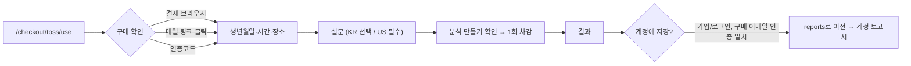
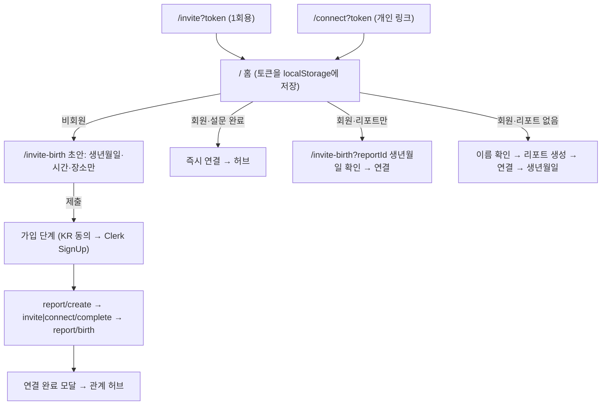
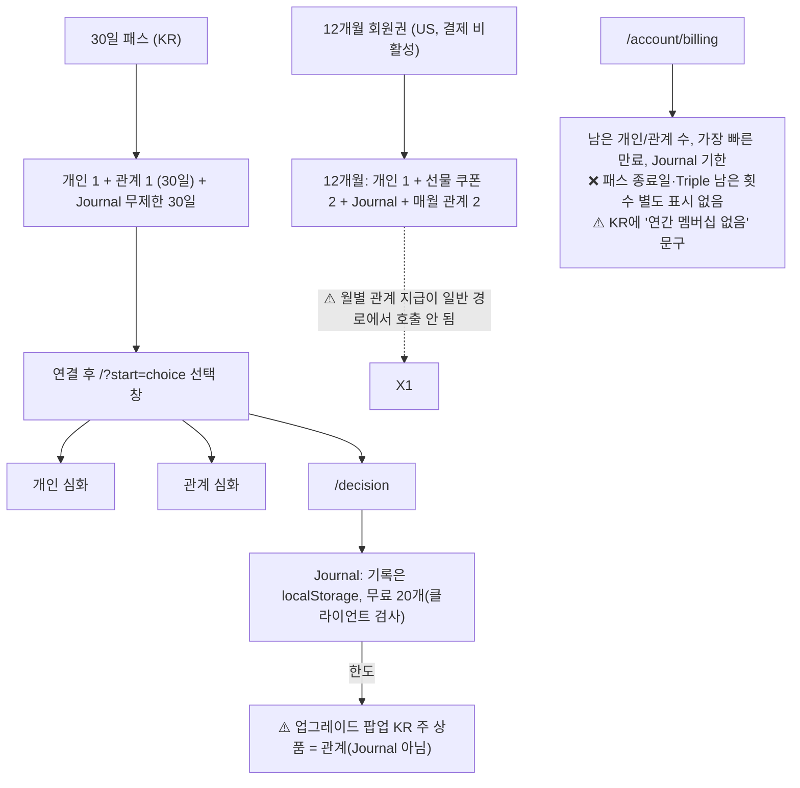

# 서비스 IA·사용자 흐름 검토와 리팩토링 계획 (2026-10-09)

- 범위: 조사와 설계만 했다. 코드 변경은 없다.
- 기준 코드: `pay/toss-guest-ux` 브랜치 31a95df(PC `pay/toss-kr-test` 브랜치의 aa3d0e6과 같은 내용).
- 표기:
  - ✅ 구현됨
  - ⚠️ 구현됐지만 의도와 다르거나 문제가 있음
  - ❌ 없음
- 실제 화면은 확인하지 못했다. 이 문서는 코드와 개발 서버 로그를 기준으로 한다.

---

## 0. 핵심 요약

1. **진입점이 너무 많고 서로 다른 규칙을 쓴다.**
   - 로그인 화면이 5종이다: 홈 모달, 설문 모달, Clerk 모달, `/sign-in`, 가드 리다이렉트.
   - 생년월일 입력 화면이 4종이고, 컴포넌트는 2종이다.
   - 내 리포트 ID를 정하는 경로가 6가지 이상이다.
2. **한국 무료 분석이 실제로는 막힌다.**
   - 한국은 "설문 선택"이라 `/onboarding/birth`에서 생년월일만 받는다.
   - 그런데 결과 화면 `/blueprint-preview`는 설문 세션이 없으면 `/survey-v2`로 되돌려 보낸다.
   - 결국 설문을 강제하는 것과 같다.
3. **비회원 무료 분석은 없다.**
   - 비회원은 설문 답변까지만 할 수 있고, 저장하려면 로그인해야 한다.
   - 시작 버튼을 눌러 로그인해도 시작하려던 의도가 저장되지 않아 처음 화면으로 돌아간다.
4. **이용권 차감에 확인 단계가 없는 곳이 있다.**
   - Personal 심화 페이지는 들어가기만 해도 생성과 차감이 시작된다.
   - 재생성과 언어 전환도 확인 없이 차감한다. 관계 재생성에는 확인 창이 있다.
5. **초대 흐름에 버그와 기기 의존성이 있다.**
   - 친구가 1명 이상인 사람이 만든 1회용 초대 링크는 목록을 다시 불러오는 순간 삭제된다.
   - 초대 토큰, 입력 초안, 연결 대기 정보가 모두 localStorage에만 있어서, 가입 중에 브라우저가 바뀌면 연결이 사라진다.
6. **기간제 상품의 이용 동선이 비어 있다.**
   - Decision Journal 기록은 기기(localStorage)에만 저장되고, 무료 20개 제한도 화면에서만 검사한다.
   - 기록 한도에 닿았을 때 한국에서 추천되는 상품이 Journal을 열어주지 않는 관계 상품이다.
   - 30일 패스 종료일과 Triple 남은 횟수를 볼 곳이 없다.
   - 미국 회원권의 월별 관계 이용권이 일반 화면에서는 지급되지 않는다.

---

## 1. 다이어그램

### 1-1. 전체 서비스 IA



- 메뉴는 세 곳에 있다.
  - 상단 헤더: 로그인 / 프로필.
  - 하단 독: 홈 · 나 · 관계 · 선택.
  - 사이드 메뉴: 대시보드, 블루프린트, 관계, 결정, 계정, 지원, 법률.
- 서버 가드는 `/account`에만 있다(`proxy.ts:15-18`). 나머지는 각 페이지가 클라이언트에서 막는다.

### 1-2. 무료 분석 진입 (비회원 / 회원)



- ❌ 비회원이 무료 결과까지 가는 경로는 없다. 비회원은 설문 초안까지만 가능하다.
- ⚠️ 한국은 생년월일만 받은 뒤 결과 화면에서 설문을 다시 강제한다.

### 1-3. 상품 선택 → 구매 → 메일 → 사용·계정 연결



- ✅ 이 흐름은 이번 작업으로 구현됐다.
- ⚠️ 미국 개별 상품(Paddle 시절 카탈로그)은 카드만 보이고 "준비 중"으로 표시된다. 미국 결제 비활성은 의도대로 유지한다.

### 1-4. Personal 비회원 분석 → 선택적으로 가입하고 저장



- ✅ 구현됨.
- ⚠️ 저장할 때 이미 계정에 내 리포트가 있으면 리포트가 두 개가 된다. 어느 쪽을 대표로 할지는 아직 정하지 않았다.

### 1-5. 관계 분석: 내 정보 준비 → 상대 추가·초대 → 분석

```mermaid
flowchart TB
  H["/relationships"] --> RD{"viewer-readiness"}
  RD -->|비회원| G1["로그인 안내 + 관계 이용권 구매(비회원)"]
  RD -->|내 정보 없음| G2["무료 내 정보 입력 → 친구 추가로 복귀"]
  RD -->|준비 완료| ADD["친구 추가 시트"]
  ADD -->|개인 연결 링크(재사용)| LINK["/connect?token 공유"]
  ADD -->|직접 입력| MAN["상대 생년월일(+설문) 입력 → 관계 생성"]
  MAN & LINK --> REL["관계 생성"] --> BASIC["기본 분석 (무료)"] --> PREM["심화 분석 💳 1회 차감"]
```

- ✅ 친구 추가 안내와 입력 후 복귀가 구현됐다.
- ⚠️ 심화 분석 첫 생성은 확인 없이 차감한다. 재생성만 확인 창이 있다.
- ⚠️ 1회용 초대 링크 삭제 버그가 있다(3장 P-7).

### 1-6. 친구 초대를 받은 사람 (코드로 확인)



- **가입 시점:** 생년월일 입력을 **제출한 직후**에 가입한다. 입력 전에는 가입하지 않는다(`app/invite-birth/page.tsx:311-315`, `:396-438`).
- **결제:** 초대받은 사람도 초대한 사람도 연결과 무료 분석에 결제가 필요 없다.
- **수락:** 지금은 양쪽 모두 자동 수락된다. 수락 대기 화면은 예전 데이터용으로만 남아 있다.
- ⚠️ 토큰과 입력 초안이 localStorage에만 있어서, 가입 중 다른 브라우저로 넘어가면 연결이 사라진다.

### 1-7. 30일 패스 · 12개월 회원권



---

## 2. 사용자 상태별 접근 규칙

| 상태 | 할 수 있는 것 | 필요한 정보·인증 | 로그인·결제 시점 | 완료 후 돌아갈 곳 | 의도 대비 |
|---|---|---|---|---|---|
| **비회원** | 모든 상품 구매(KR), 비회원 Personal 분석, 설문 초안, 랜딩·안내 보기, 초대 링크로 생년월일 입력 | 구매 이메일. Personal 이용 시 구매 확인(링크, 코드, 결제 브라우저) | 무료 분석은 시작 즉시 로그인 요구. 계정 상품은 이용할 때 로그인 | 로그인 후 홈(⚠️ 의도 잃음). 구매는 완료 화면 | ✅ 비회원 구매 / ✅ Personal 비회원 분석 / ⚠️ 무료 분석은 회원 전용인데 안내가 "로그인은 선택"으로 섞임 |
| **로그인 · 정보 미완료** | 구매, 이용권 연결, 내 정보 입력 시작 | KR 생년월일(설문 선택), US 설문 + 생년월일 | 정보 입력 전에 결제 필요 없음 | 입력 후 결과 화면, 또는 친구 추가에서 시작했으면 친구 추가 | ⚠️ KR 결과 화면이 설문을 강제 |
| **정보 완료** | 무료 개인 결과, 친구 추가·연결, 기본 관계 분석, Journal 20개 | 없음 | 심화 분석 시 결제(이용권 없으면 구매 팝업) | 해당 분석 화면 | ✅ 무료 개인·관계 / ✅ 관계 준비에 유료 Personal 불필요 |
| **이용권 보유** | Personal 심화, 관계 심화(종류·언어별 1회), 패스·회원권은 Journal 무제한 | 계정 연결된 이용권(구매일 기준 기한) | 생성할 때 차감 | 생성된 보고서 | ⚠️ Personal 심화는 페이지에 들어가기만 해도 차감, 재생성·언어 전환도 확인 없음 |

미국: 회원권만 Toss 카탈로그에 있고 결제는 비활성이다. 개별 상품 카드는 "준비 중"으로 보인다. 이 상태는 그대로 둔다.

---

## 3. 구조 문제 (파일과 사용자 불편)

| # | 문제 | 관련 파일 | 사용자 불편 |
|---|---|---|---|
| P-1 | 한국 결과 화면이 설문을 강제 | `app/blueprint-preview/page.tsx:39-46`, `[reportId]/current/page.tsx:41`, `essence/page.tsx:51` | 생년월일을 넣었는데 다시 설문으로 튕긴다 |
| P-2 | 시작 의도가 로그인 후 사라짐 | `app/homecontent.tsx:591-595`, `HomeAuthSignInPanel.tsx:27` | 로그인 후 "시작하기"를 다시 눌러야 한다 |
| P-3 | 로그인 화면 5종 | 홈 모달, `SurveyAuthSignInPanel`, 헤더·독 `openSignIn`, `/sign-in`, `RedirectToSignIn` | 같은 행동인데 화면마다 모양과 복귀 위치가 다르다 |
| P-4 | 생년월일 입력 4곳, 컴포넌트 2종 | `onboarding/birth`(어두운 폼, 장소 모름 없음), `survey-v2/complete`, `invite-birth`, `checkout/toss/use` | 톤이 다르고 선택지(장소 모름)도 다르다 |
| P-5 | 내 리포트 ID 출처 6가지 이상 | localStorage `reportId`, URL `reportId`/`myReportId`, `/api/home/resume`, `useClientReportId`, `resolveCanonicalReportIdClient` | 다른 기기나 브라우저에서 "내 정보 없음"으로 보이거나 엉뚱한 리포트를 쓴다 |
| P-6 | 설문·생년월일 완료 여부를 브라우저 세션으로 판단 | `ahaitsme_v2_survey_<id>`, birth session, `survey-v2/complete:96-99` | 세션이 없으면 아무 안내 없이 홈으로 튕긴다 |
| P-7 | **1회용 초대 링크 즉시 삭제** | `app/api/relationship/list/route.ts:90`, `lib/relationship/cleanupStaleOpenInvites.ts` | 친구가 있는 사람이 보낸 초대가 404로 열리지 않는다 |
| P-8 | 초대·연결 상태가 localStorage에만 있음 | `homecontent.tsx:94-99`, `invite-birth`, `completeInviteOrConnectSignup.ts` | 메일 인증이나 인앱 브라우저 전환 때 연결이 사라진다 |
| P-9 | 초대 경유 가입자의 "완료" 판정이 설문 기준 | `lib/home/resolveCanonicalReport.ts:143`, `homecontent.tsx:283` | 다음 초대 때 다시 생년월일 화면으로 가고, 연결 알림 팝업도 오지 않는다 |
| P-10 | 초대 경유 가입은 표시 이름 단계를 건너뜀 | `completeInviteOrConnectSignup.ts` | 상대 화면에 "누군가"로 보인다 |
| P-11 | Personal 심화가 페이지 진입만으로 차감 | `lib/v1/slim/useSlimV1Integrated.ts:228-231`, `deep/page.tsx:216-222`, `api/v2/deep/essence:86-90` | 둘러보기만 해도, 언어만 바꿔도 이용권이 사용된다 |
| P-12 | 관계 심화 첫 생성에 확인 없음 | `RelationshipPremiumSection.tsx:438` | 클릭 한 번에 차감된다(재생성은 확인 있음, 규칙이 다름) |
| P-13 | Journal 기록이 기기 저장, 한도는 클라이언트만 | `components/decision/DecisionJournalContent.tsx` | 기기를 바꾸면 기록이 사라진다. 패스의 "기록 관리" 약속과 맞지 않는다 |
| P-14 | Journal 한도 → 잘못된 상품 추천 | `DecisionJournalContent.tsx:358-368,492` (`context="account"`) | 한국에서 관계 상품을 사도 Journal은 열리지 않는다 |
| P-15 | 이용권 현황이 부족 | `app/account/billing/page.tsx:219-275`, ko-KR `:497-498` | 패스 종료일과 Triple 남은 횟수를 모르고, 한국 사용자에게 "연간 멤버십 없음"이 보인다 |
| P-16 | 회원권 월별 관계 이용권 미지급 (US) | `ensure_monthly_relationship_grant` 호출 위치 | 회원인데 관계 이용권이 0으로 보인다(미국 결제 활성 전에 고쳐야 함) |
| P-17 | 구매 팝업이 항상 전체 상품 목록 | `PurchaseSelectorContent.tsx:232` | 맥락과 상관없는 상품까지 보여서 고르기 어렵다 |
| P-18 | 죽은 코드와 경로 | `/api/invite/accept`(410), `app/invite/accept`, `/api/invites/pending`, `/api/relationship/upgrade`, `/thank-you`, `RegionalPricingCards` | 유지보수 혼란. 사용자 영향은 적다 |
| P-19 | 하드코딩 영어와 모순 문구 | `survey-v2/page.tsx:371-393`, `StartChoiceModal`("무료 체험은 로그인 후" + "로그인은 선택") | 한국 화면에 영어가 보이고 안내가 서로 어긋난다 |
| P-20 | 한국 동의 리다이렉트 후 원래 흐름 상실 | `onboarding/legal-consent/page.tsx:91` | 동의 후 항상 홈으로 가서 하던 일을 잃는다 |
| P-21 | 뒤로 가기 반복 | `homecontent.tsx:642,727` (`router.push`) | 초대 흐름에서 뒤로 가면 다시 앞으로 튕긴다 |
| P-22 | 공개 무료 LLM 엔드포인트 | `/api/v2/lite/current` (인증 없음) | 사용자 불편은 아니고 비용·악용 위험이다 |
| P-23 | 비회원 Personal 저장 시 리포트 2개 | `save_guest_personal_to_account` | 계정에 내 리포트가 두 개가 된다 |

---

## 4. 목표 구조

### 4-1. 원칙

1. **하나의 "내 정보" 상태.** 서버가 정하는 `viewerProfile` 하나로 판단한다: 리포트 ID, 생년월일 여부, 설문 여부, 지역 규칙. 페이지별 localStorage 판단을 없앤다.
2. **하나의 "이어서 하기"(복귀) 장치.** 로그인, 동의, 내 정보 입력 뒤에 돌아갈 곳을 한 가지 방식으로 저장한다. 서버 쿠키나 URL `next`를 쓰고, 기기가 바뀌어도 유지되게 한다.
3. **하나의 입력 화면.** 생년월일 → 설문(지역 규칙) 단계를 하나로 만든다. 회원, 초대, 비회원 Personal, 관계 준비가 같은 화면을 쓴다.
4. **차감은 항상 확인 후.** 생성할 때 확인 → 예약 → 생성 → 확정. 페이지 진입, 재생성, 언어 전환으로는 자동 차감하지 않는다.
5. **상품은 "무엇을 열어주는가"로 안내.** 구매 팝업은 맥락에 맞는 상품만 먼저 보여준다(Journal → 패스).

### 4-2. 현재 vs 목표

| 흐름 | 현재 | 목표 |
|---|---|---|
| 무료 개인 분석 | 시작 → 로그인 → (의도 잃음) → 다시 시작 → 이름 → KR 생년월일 → 결과에서 설문 강제 | 시작 → 로그인(복귀 유지) → 이름 → **공통 입력**(생년월일 → 설문, KR 건너뛰기 가능) → 결과 |
| 관계 준비 | 허브 안내 → 지역별 다른 입력 페이지 → 복귀 | 허브 안내 → **공통 입력** → 친구 추가 시트로 복귀 |
| 초대받은 사람 | `/invite` → `/` → `/invite-birth` → 가입 → 3단계 API | `/invite` 한 페이지 안에서: 생년월일 → 가입(토큰은 서버 쿠키에 보관) → 연결 → 결과 |
| 비회원 Personal | 구매 → 확인 → 입력(공통 폼) → 생성 확인 → 결과 → 선택 저장 | 유지. 입력 화면만 공통 입력으로 교체 |
| 계정 상품 | 구매 → 가입/로그인 → 자동 연결 → 상품별 화면 | 유지. 연결 뒤 "공통 입력"과 복귀 장치 재사용 |
| 심화 생성 | Personal은 자동 차감, 관계는 첫 생성만 즉시 차감 | 둘 다 **확인 후 차감**, 같은 확인 컴포넌트 |
| 30일 패스 | 선택 창, Journal은 기기 저장 | 선택 창 + Journal 서버 저장(결정 필요), 계정에 종료일 표시 |

### 4-3. 공통화할 것 / 상품별로 남길 것

- **공통화**
  - `viewerProfile` 서버 상태(리포트, 생년월일, 설문, 지역 규칙)
  - 복귀 장치
  - 입력 화면(생년월일 + 설문)
  - 로그인 진입 컴포넌트 1개(모달 / 페이지 두 형태)
  - 생성 확인 → 차감 컴포넌트
  - 구매 팝업(맥락별 추천)
  - 계정의 이용권 현황
- **상품별로 남길 것**
  - 각 상품의 지급 내용, 기한, 환불 문구(`accountLinkCopy`, 결제 SQL)
  - Personal 비회원 이용(구매 확인, 임시 보관, 저장 이전)
  - 관계의 상대 추가·초대
  - Journal 기록과 접근 판정

---

## 5. 단계별 리팩토링 계획 (기능 보존, 작은 단위)

| 단계 | 내용 | 주요 파일 | 보존·검증 |
|---|---|---|---|
| **0. 버그 우선** | P-7 초대 삭제 수정(목록 조회에서 자동 삭제 제거, 오래된 초대만 별도 정리). P-1 KR 결과 화면이 지역 규칙을 따르게 | `relationship/list`, `cleanupStaleOpenInvites`, `blueprint-preview/*` | 초대·연결 테스트 추가. KR/US 각각 결과 진입 |
| **1. 상태 일원화** | `GET /api/me/profile`(viewerProfile) 추가 후, 허브·결과·구매 후 이동이 이것만 보게 전환. localStorage는 캐시로만 | `lib/home/*`, `useClientReportId`, `friendAddReadiness`, `postPurchaseDestination` | 기존 리포트·보고서 데이터 변경 없음. 읽기 전용 API |
| **2. 복귀 장치 통일** | `next` 파라미터 + 서버 쿠키 하나로 로그인, 동의, 입력 후 복귀 처리. 시작 의도 보존(P-2, P-20) | `selfProfileReturn`, `homecontent`, `legal-consent`, sign-in/up | 오픈 리다이렉트 방지(상대 경로만 허용) |
| **3. 공통 입력 화면** | `/onboarding/profile`(가칭) 하나: 생년월일(Stitch 폼) → 설문(KR 선택 / US 필수). 기존 4곳을 이 화면으로 연결 | `onboarding/birth`, `survey-v2/complete`, `invite-birth`, `GuestUseClient` | 저장 API(`/api/report/birth`, 설문 저장)는 그대로 재사용 |
| **4. 초대 흐름 정리** | 토큰을 서버 쿠키에 보관(P-8), `/invite` 한 페이지 안에서 진행, 표시 이름 단계 포함(P-10), 완료 판정을 생년월일 기준으로(P-9) | `invite*`, `connect*`, `completeInviteOrConnectSignup` | 자동 수락, 멱등 연결 유지 |
| **5. 차감 확인 통일** | 심화 생성 확인 컴포넌트를 Personal·관계 공통으로. 페이지 진입 자동 생성 제거(P-11, P-12) | `useSlimV1Integrated`, `deep/page`, `RelationshipPremiumSection` | 예약·확정·해제 멱등 그대로. 저장된 보고서 재사용 |
| **6. 구매·이용권 화면** | 맥락별 추천(P-14, P-17), 계정에 상품별 현황(패스 종료일, Triple 잔여, KR 문구, P-15) | `PurchaseSelectorContent`, `account/billing`, entitlements API | 미국 결제 비활성 유지 |
| **7. 정리** | 죽은 경로 제거(P-18), 하드코딩 영어(P-19), 뒤로 가기(P-21), 공개 LLM 엔드포인트 보호(P-22) | 해당 파일 | 회귀 테스트 |
| 보류(결정 후) | Journal 서버 저장(P-13), 회원권 월 지급(P-16, 미국 활성 전), 비회원 Personal 저장 시 대표 리포트(P-23) | — | DB 변경은 DEV에서만 |

계속 지킬 것:
- 이메일 소유권 검증
- 1회 지급과 멱등 차감
- 기존 구매·보고서 데이터
- 상품별 기한(구매일 기준)과 환불 조건
- 테스트 결제 제한

각 단계는 별도 브랜치·커밋으로 진행하고, 단계마다 모의 테스트와 로컬 화면 확인을 거친다.

---

## 6. 먼저 결정할 사항

1. **비회원 무료 개인 분석을 허용할까?** 지금은 회원 전용이다.
   - 허용: 진입 장벽이 낮아지지만, 비회원 데이터 보관 규칙과 LLM 비용 보호가 필요하다.
   - 유지: 시작 화면에서 "무료 분석은 가입 후"를 분명히 하고, 로그인 후 바로 이어지게만 만든다.
2. **한국 설문 정책.** "선택" 유지(결과 화면도 설문 없이 열리게)인지, 무료 결과에서는 설문을 받을지.
3. **초대받은 사람의 가입 시점.** 지금처럼 "생년월일 입력 후 가입"으로 둘지, 비회원으로 기본 관계 결과를 먼저 보여줄지(정보 보관 동의 문제).
4. **Decision Journal 기록을 서버에 저장할까?** 30일 패스의 "기록 관리" 약속과 연결된다. DB 변경이 필요하고 DEV부터 진행한다.
5. **심화 분석 언어 전환 정책.** 같은 보고서를 다른 언어로 볼 때 추가 차감할지, 번역만 할지.
6. **비회원 Personal 결과를 저장할 때** 기존 내 리포트가 있으면 어느 것을 대표로 할지.
